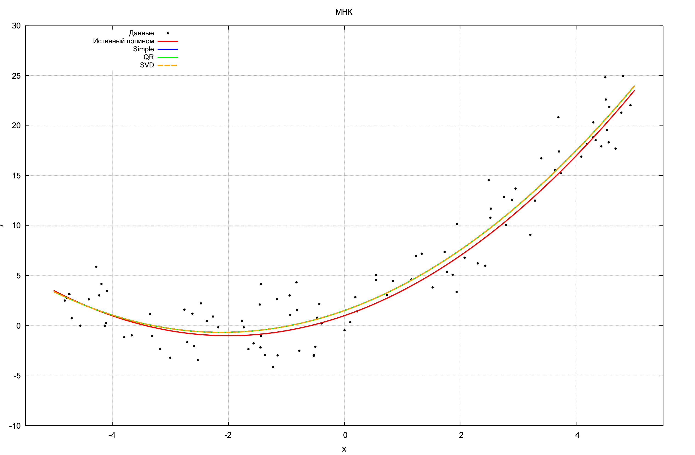

# Лабораторная работа 1: МНК

**Задача:** найти $x$ из $Ax = b$ методом наименьших квадратов.

**Метод 1:** $x = (A^T A)^{-1} A^T b$

**Метод 2 (QR):** $A = QR \implies Rx = Q^T b$

**Метод 3 (SVD):** $A = U \Sigma V^T \implies x = V \Sigma^+ U^T b$

---

## 1. Simple

### Идея

Свести задачу минимизации невязки ‖Ax − b‖² к уравнению AᵀA x = Aᵀb, а затем решить его через обратную матрицу.

### Формула
$$x = (A^T A)^{-1} A^T b$$

**Вход:** $A$ ($N \times m$), $b$ ($N$).
**Выход:** $x$ ($m$).

### Вывод формулы

Задача МНК — минимизировать невязку:

$$f(x) = \lVert Ax - b \rVert^2 = (Ax - b)^T (Ax - b)$$

Раскрываем квадрат:

$$f(x) = (Ax)^T (Ax) - (Ax)^T b - b^T (Ax) + b^T b$$

Учитывая, что $(Ax)^T (Ax) = x^T A^T A x$ и $(Ax)^T b = b^T (Ax) = x^T A^T b$:

$$f(x) = x^T A^T A x - 2 x^T A^T b + b^T b$$

Это функция от $x$. Её минимум — в точке, где градиент равен нулю:

$$\frac{\partial f}{\partial x} = 2 A^T A x - 2 A^T b = 0$$

Отсюда получаем уравнение МНК:

$$A^T A x = A^T b$$

Если матрица $A^T A$ обратима, то:

$$x = (A^T A)^{-1} A^T b$$

### Шаги алгоритма

1. **Транспонирование матрицы $A$:**

$$A^T = \begin{pmatrix}
a_{11} & a_{21} & \dots & a_{N1} \\
a_{12} & a_{22} & \dots & a_{N2} \\
\vdots & \vdots & \ddots & \vdots \\
a_{1m} & a_{2m} & \dots & a_{Nm}
\end{pmatrix}$$

2. **Матрица $A^T A$ размера ($m \times m$):**

$$(A^T A)_{ij} = \sum_{k=1}^{N} a_{ki} \cdot a_{kj}$$

3. **Вектор $A^T b$ размера ($m$):**

$$(A^T b)_i = \sum_{k=1}^{N} a_{ki} \cdot b_k$$

4. **Обращение матрицы:** $(A^T A)^{-1}$

5. **Вычисление итогового ответа:** $x = (A^T A)^{-1} A^T b$

---

## 2. QR-разложение (Хаусхолдер)

### Идея
$A = QR \implies A^T A x = A^T b \implies R x = Q^T b$

**Вход:** $A$ ($N \times m$, $N \ge m$).
**Выход:** $Q_1$ ($N \times m$), $R_1$ ($m \times m$).

### Шаги

**Инициализация:**
$R := A, \quad Q_1 := I_{N \times m}$

**Для каждого $k = 0, 1, \dots, m-1$:**

1. Столбец $x = R[k : N-1, k]$.
2. Вектор Хаусхолдера:
   
$$\alpha = -\text{sign}(x_1) \cdot \Vert{}x\Vert{}_2$$
$$v = x - \alpha \cdot e_1$$
$$u = \frac{v}{\Vert{}v\Vert{}_2}$$

3. Матрица отражения: 
$H_k = I - 2 \cdot u \cdot u^T$

Распишем $H_k R$ покомпонентно. Элемент $(i, j)$:

$$(H_k R)_{ij} = R_{ij} - 2 \cdot u_i \cdot \sum_{l=k}^{N-1} u_l \cdot R_{lj}$$

Обозначим:

$$\text{dot}_j = \sum_{l=k}^{N-1} u_l \cdot R_{lj}$$

Остаётся:
$R[i][j] \mathrel{-}= 2 \cdot \text{dot}_j \cdot u_i \quad (i = k \dots N-1, \ j \ge k)$

Сохраняем $u$ в массив `us`.

**Накопление $Q_1$** — идём по `us` в обратном порядке ($k = m-1, \dots, 0$), так как $Q = H_0 \cdot H_1 \dots H_{m-1}$:

$$\text{dot} = \sum_{i=k}^{N-1} u_i \cdot Q_1[i][j]$$
$$Q_1[i][j] \mathrel{-}= 2 \cdot \text{dot} \cdot u_i$$

**Извлечение $R_1$:**
$R_1[i][j] = R[i][j] \quad (i, j = 0 \dots m-1)$

**Решение $Rx = Q^T b$:**

$$c_i = \sum_{k=0}^{N-1} Q_1[k][i] \cdot b_k$$

Обратная подстановка, для $i = m-1, \dots, 0$:

$$x_i = \frac{c_i - \sum_{j=i+1}^{m-1} R_1[i][j] \cdot x_j}{R_1[i][i]}$$

---

## 3. SVD

### Формула
$A = U \Sigma V^T \implies x = V \Sigma^+ U^T b$

**Вход:** $A$ ($N \times m$), $b$ ($N$).
**Выход:** $x$ ($m$).

### Шаги

**SVD (Eigen::JacobiSVD):**
$A = U \Sigma V^T$

где:
* $U$ — матрица $N \times m$
* $\Sigma$ — матрица $m \times m$, диагональная
* $V$ — матрица $m \times m$

**Псевдообратная:**
$\Sigma^+_{ii} = \frac{1}{\sigma_i}$, если $\sigma_i > 0$
$A^+ = V \Sigma^+ U^T$

**Ответ:**
$x = A^+ b = V \Sigma^+ U^T b$

---

## Результаты тестов

| № | Тест | $\text{cond}(A^T A)$ | Simple | QR | SVD |
|---|---|---|---|---|---|
| 1 | Хорошая A (Вандермонд) | $7.4 \cdot 10^3$ | 0 | 0 | 0 |
| 2 | Почти линейно зависимые столбцы | $1.5 \cdot 10^{16}$ | 0.21 | 1.41 | 1.41 |
| 3 | Вырожденная A (ранг 1) | $\infty$ | nan | мусор | 0.45 |
| 4 | Большой разброс значений | $10^{16}$ | 0 | 0 | 0 |
| 5 | Почти вырожденная A | $2.6 \cdot 10^{16}$ | $2 \cdot 10^{-8}$ | $1.8 \cdot 10^{-4}$ | $4.2 \cdot 10^{-4}$ |
| 6 | Разреженная A | $10^{12}$ | $1.7 \cdot 10^{-6}$ | $1.7 \cdot 10^{-6}$ | $1.7 \cdot 10^{-6}$ |

## Выводы

* **Тест 1 (Хорошая A, Вандермонд).** $\text{cond}(A^T A) = 7.4 \cdot 10^3$. При хорошей обусловленности все три метода дают точное решение (err = 0).
* **Тест 2 (Почти линейно зависимые столбцы).** $\text{cond}(A^T A) = 1.5 \cdot 10^{16}$. Задача неразрешима — все методы дают разные ответы, все неверные. Но QR и SVD совпадают друг с другом.
* **Тест 3 (Вырожденная A, ранг 1).** $\text{cond}(A^T A) = \infty$. Simple дал nan, QR дал мусор, SVD дал псевдорешение.
* **Тест 4 (Большой разброс значений).** $\text{cond}(A^T A) = 10^{16}$. Разреженная структура — все методы справляются.
* **Тест 5 (Почти вырожденная A).** $\text{cond}(A^T A) = 2.6 \cdot 10^{16}$. Simple случайно оказался точнее всех.
* **Тест 6 (Разреженная A).** $\text{cond}(A^T A) = 10^{12}$. Все три метода дают одинаковый результат.

## График

## Сборка

    g++ lb1.cpp -o lb1
    ./lb1

Для графика (нужен Gnuplot):

    gnuplot -persist -c src/plot.gp points.txt poly.txt

## Файлы

| Файл | Описание |
|---|---|
| [`src/lb1.cpp`](src/lb1.cpp) | Исходный код на C++ |
| [`src/plot.gp`](src/plot.gp) | Скрипт Gnuplot |
| [`graph.png`](graph.png) | График решения МНК |
