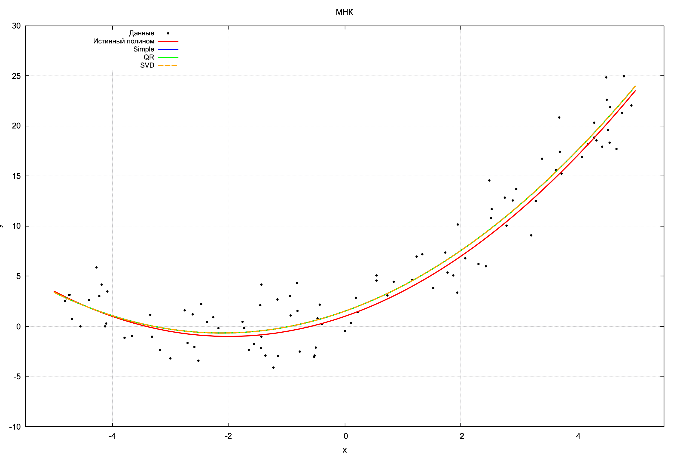

# Лабораторная работа 1: МНК

**Задача:** найти $x$ из $Ax = b$ методом наименьших квадратов.

**Метод 1:** $x = (A^T A)^{-1} A^T b$

**Метод 2 (QR):** $A = QR \implies Rx = Q^T b$

**Метод 3 (SVD):** $A = U \Sigma V^T \implies x = V \Sigma^+ U^T b$

---

## 1. Simple

### Идея

Свести задачу минимизации невязки ‖Ax − b‖² к уравнению AᵀA x = Aᵀb, а затем решить его через обратную матрицу.

### Формула
$$x = (A^T A)^{-1} A^T b$$

**Вход:** $A$ ($N \times m$), $b$ ($N$).
**Выход:** $x$ ($m$).

### Вывод формулы

Задача МНК — минимизировать невязку:

$$f(x) = \lVert Ax - b \rVert^2 = (Ax - b)^T (Ax - b)$$

Раскрываем квадрат:

$$f(x) = (Ax)^T (Ax) - (Ax)^T b - b^T (Ax) + b^T b$$

Учитывая, что $(Ax)^T (Ax) = x^T A^T A x$ и $(Ax)^T b = b^T (Ax) = x^T A^T b$:

$$f(x) = x^T A^T A x - 2 x^T A^T b + b^T b$$

Это функция от $x$. Её минимум — в точке, где градиент равен нулю:

$$\frac{\partial f}{\partial x} = 2 A^T A x - 2 A^T b = 0$$

Отсюда получаем уравнение МНК:

$$A^T A x = A^T b$$

Если матрица $A^T A$ обратима, то:

$$x = (A^T A)^{-1} A^T b$$

### Шаги алгоритма

1. **Транспонирование матрицы $A$:**

$$A^T = \begin{pmatrix}
a_{11} & a_{21} & \dots & a_{N1} \\
a_{12} & a_{22} & \dots & a_{N2} \\
\vdots & \vdots & \ddots & \vdots \\
a_{1m} & a_{2m} & \dots & a_{Nm}
\end{pmatrix}$$

2. **Матрица $A^T A$ размера ($m \times m$):**

$$(A^T A)_{ij} = \sum_{k=1}^{N} a_{ki} \cdot a_{kj}$$

3. **Вектор $A^T b$ размера ($m$):**

$$(A^T b)_i = \sum_{k=1}^{N} a_{ki} \cdot b_k$$

4. **Обращение матрицы:** $(A^T A)^{-1}$

5. **Вычисление итогового ответа:** $x = (A^T A)^{-1} A^T b$

---

## 2. QR-разложение (Хаусхолдер)

### Идея
$A = QR \implies A^T A x = A^T b \implies R x = Q^T b$

**Вход:** $A$ ($N \times m$, $N \ge m$).
**Выход:** $Q_1$ ($N \times m$), $R_1$ ($m \times m$).

### Шаги

**Инициализация:**
$R := A, \quad Q_1 := I_{N \times m}$

**Для каждого шага $k = 0, 1, \dots, \min(N, m) - 1$:**

1. Столбец $x = R[k : N-1, k]$.
2. Вектор Хаусхолдера:
   
$$\alpha = -\text{sign}(x_1) \cdot \Vert{}x\Vert{}_2$$
$$v = x - \alpha \cdot e_1$$
$$u = \frac{v}{\Vert{}v\Vert{}_2}$$

3. Матрица отражения: 
$H_k = I - 2 \cdot u \cdot u^T$

Распишем $H_k R$ покомпонентно. Элемент $(i, j)$:

$$(H_k R)_{ij} = R_{ij} - 2 \cdot u_i \cdot \sum_{l=k}^{N-1} u_l \cdot R_{lj}$$

Обозначим:

$$\text{dot}_j = \sum_{l=k}^{N-1} u_l \cdot R_{lj}$$

Остаётся:
$R[i][j] \mathrel{-}= 2 \cdot \text{dot}_j \cdot u_i \quad (i = k \dots N-1, \ j \ge k)$

Сохраняем $u$ в массив `us`.

**Накопление $Q_1$** — идём по `us` в обратном порядке ($k = m-1, \dots, 0$), так как $Q = H_0 \cdot H_1 \dots H_{m-1}$:

$$\text{dot} = \sum_{i=k}^{N-1} u_i \cdot Q_1[i][j]$$
$$Q_1[i][j] \mathrel{-}= 2 \cdot \text{dot} \cdot u_i$$

**Извлечение $R_1$:**
$R_1[i][j] = R[i][j] \quad (i, j = 0 \dots m-1)$

**Решение $Rx = Q^T b$:**

$$c_i = \sum_{k=0}^{N-1} Q_1[k][i] \cdot b_k$$

Обратная подстановка, для $i = m-1, \dots, 0$:

$$x_i = \frac{c_i - \sum_{j=i+1}^{m-1} R_1[i][j] \cdot x_j}{R_1[i][i]}$$

---

## 3. SVD

### Формула
$A = U \Sigma V^T \implies x = V \Sigma^+ U^T b$

**Вход:** $A$ ($N \times m$), $b$ ($N$).
**Выход:** $x$ ($m$).

### Шаги

**SVD (Eigen::JacobiSVD):**
$A = U \Sigma V^T$

где:
* $U$ — матрица $N \times m$
* $\Sigma$ — матрица $m \times m$, диагональная
* $V$ — матрица $m \times m$

**Псевдообратная:**
$\Sigma^+_{ii} = \frac{1}{\sigma_i}$, если $\sigma_i > 0$
$A^+ = V \Sigma^+ U^T$

**Ответ:**
$x = A^+ b = V \Sigma^+ U^T b$

---

## Результаты тестов

В таблице приведены результаты сравнения четырех методов решения системы \(Ax = b\):
- **Simple**
- **QR**
- **SVD**
- **Tikh** (регуляризация Тихонова, alpha = 1e-6)

## Сводная таблица

### Результаты тестов численных методов
| № | Тест | cond(A) | cond(A^T A) | Метод | res | \|grad\| | \|x\| | t (ms) | err |
|---|---|---|---|---|---|---|---|---|---|
| **1** | Хорошая A (Вандермонд) | 85.9 | 7.4e3 | Simple | 0.000000 | 6.35e-12 | 1.732 | 0.072 | 0.000000 |
| | | | | QR | 0.000000 | 2.27e-14 | 1.732 | 0.018 | 0.000000 |
| | | | | SVD | 0.000000 | 3.04e-13 | 1.732 | 0.009 | 0.000000 |
| **2** | Почти линейно зависимые | 1.4e8 | 1.5e16 | Simple | 0.556334 | 1.76e+00 | 1.595 | 0.004 | 1.308246 |
| | | | | QR | 0.000000 | 0.00e+00 | 2.000 | 0.005 | 0.000000 |
| | | | | SVD | 0.000000 | 4.40e-15 | 2.000 | 0.004 | 0.000000 |
| | | | | Tikh | 0.000000 | 1.33e-07 | 1.414 | 0.004 | 1.414213 |
| **3** | Вырожденная A (ранг 1) | 1.0e16 | inf | Simple | FAIL | — | — | — | — |
| | | | | QR | 0.000000 | 6.86e-12 | 1028.632 | 0.020 | — |
| | | | | SVD | 0.000000 | 0.00e+00 | 1.342 | 0.005 | — |
| | | | | Tikh | 0.000001 | 1.20e-05 | 1.342 | 0.004 | — |
| **4** | Большой разброс значений | 1.6e7 | 2.6e14 | Simple | 0.000000 | 2.22e-16 | 1.414 | 0.017 | 0.000000 |
| | | | | QR | 0.000000 | 1.46e-04 | 1.414 | 0.005 | 0.000000 |
| | | | | SVD | 0.000000 | 1.46e-04 | 1.414 | 0.005 | 0.000000 |
| **5** | Почти вырожденная A | 1.8e6 | 2.6e16 | Simple | 0.000000 | 1.15e-07 | 1.414 | 0.003 | 0.000000 |
| | | | | QR | 0.000000 | 1.88e-15 | 1.414 | 0.004 | 0.000176 |
| | | | | SVD | 0.000000 | 1.88e-15 | 1.414 | 0.003 | 0.000421 |
| | | | | Tikh | 0.000000 | 1.70e-11 | 1.414 | 0.003 | 0.000000 |
| **6** | Разреженная A | 1000 | 1.0e12 | Simple | 0.000000 | 3.14e-16 | 2.000 | 0.017 | 0.000000 |
| | | | | QR | 0.000000 | 0.00e+00 | 2.000 | 0.005 | 0.000000 |
| | | | | SVD | 0.000000 | 2.48e-16 | 2.000 | 0.003 | 0.000000 |
| **7** | Матрица 200x200 | 100 | 1.0e4 | Simple | 0.000000 | 1.64e-13 | 8.448 | 1.478 | 0.000000 |
| | | | | QR | 0.000000 | 1.30e-15 | 8.448 | 13.985 | 0.000000 |
| | | | | SVD | 0.000000 | 1.03e-14 | 8.448 | 45.417 | 0.000000 |
| **8** | Полином (с шумом) | 17.0 | 288.8 | Simple | 18.484673 | 3.51e-12 | 2.017 | 0.000833 | 0.718674 |
| | | | | QR | 18.484673 | 2.46e-12 | 2.017 | 0.002041 | 0.718674 |
| | | | | SVD | 18.484673 | 7.99e-12 | 2.017 | 0.000459 | 0.718674 |

**Примечания:**
* `res` — невязка (||Ax - b||).
* `|grad|` — норма градиента (||A^T(Ax - b)||), показывающая, попал ли метод в минимум.
* `|x|` — норма найденного вектора решения.
* `t` — время выполнения в миллисекундах.
* `err` — отклонение от истинных коэффициентов.

## Выводы

*   **Тест 1 (Хорошая A, Вандермонд).** `cond(A) = 85.9`, `cond(A^T A) = 7.4e3`. Все методы дают точное решение (`err = 0`), градиенты практически нулевые.
*   **Тест 2 (Почти линейно зависимые).** `cond(A) = 1.4e8`, `cond(A^T A) = 1.5e16`. Матрица \(A^T A\) почти вырождена, поэтому `simple` (через `inverse`) теряет точность: выдает `err = 1.3`, невязку `0.55` и огромный градиент `1.7`. QR и SVD работают с исходной \(A\) и находят точный ответ (`err = 0`). Тихонов находит решение минимальной нормы `(1,1)` с `err = 1.41`.
*   **Тест 3 (Вырожденная A, ранг 1).** `cond(A^T A) = inf`. Матрица \(A^T A\) строго вырождена. `simple` падает (`FAIL`). QR находит решение, но это «мусор» с огромной нормой (`|x| = 1028`). SVD и Тихонов находят минимальное по норме решение (`|x| = 1.34`).
*   **Тест 4 (Большой разброс).** `cond(A) = 1.6e7`, `cond(A^T A) = 2.6e14`. Несмотря на огромный разброс значений (от 1e7 до 1e-7), все методы находят точный ответ (`err = 0`). Градиент у QR и SVD немного больше (`1.46e-4`). Метод `simple` показал хороший результат из-за диагональной структуры матрицы.
*   **Тест 5 (Почти вырожденная A).** `cond(A^T A) = 2.6e16`. `simple` случайно находит точный ответ (`err = 0`), но его градиент `1.1e-7` говорит о нестабильности. QR и SVD стабильны (градиент `1e-15`), но ошибаются в коэффициентах на `1e-4`. Тихонов выдает точный ответ (`err = 0`) с градиентом (`1e-11`).
*   **Тест 6 (Разреженная A).** `cond(A^T A) = 1.0e12`. Все методы дают точный результат (`err = 0`).
*   **Тест 7 (Матрица 200x200).** `cond(A^T A) = 1.0e4`. Все методы точны (`err = 0`), но по времени: Simple (1.48 мс), QR (13.99 мс), SVD (45.42 мс).
*   **Тест 8 (Полином, шум).** `cond(A) = 17.0`. Все методы выдают одинаковые коэффициенты. `res ≈ 18.5`, `err ≈ 0.72` (в этом запуске шум сильно сместил оценки), градиент `~1e-12`.
 
## График

## Сборка

    g++ lb1.cpp -o lb1
    ./lb1

Для графика (нужен Gnuplot):

    gnuplot -persist -c src/plot.gp points.txt poly.txt

## Файлы

| Файл | Описание |
|---|---|
| [`src/lb1.cpp`](src/lb1.cpp) | Исходный код на C++ |
| [`src/plot.gp`](src/plot.gp) | Скрипт Gnuplot |
| [`graph.png`](graph.png) | График решения МНК |
